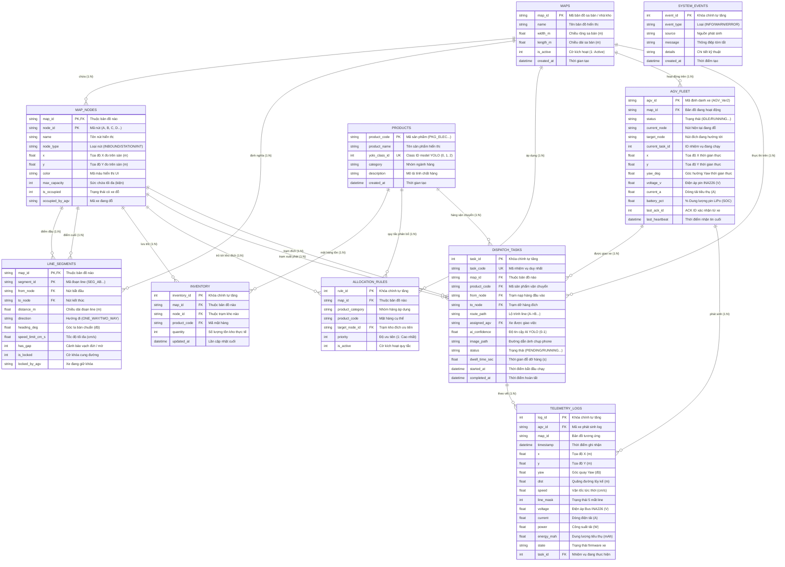

# ĐẶC TẢ CHI TIẾT CƠ SỞ DỮ LIỆU & SƠ ĐỒ QUAN HỆ (ERD)
# AGV_VER2 WMS SYSTEM (PHIÊN BẢN V2.1)
> **Căn cứ kỹ thuật:** Quản lý Đa Bản đồ Mạng lưới Line Động, Tồn kho Đa mặt hàng và Điều phối Đội xe thông minh.  
> **Cập nhật:** 2026-11-05

---

## 1. SƠ ĐỒ QUAN HỆ THỰC THỂ (ENTITY RELATIONSHIP DIAGRAM - ERD)

---

## 2. TỪ ĐIỂN DỮ LIỆU CHI TIẾT (DATA DICTIONARY)

### 2.1. Nhóm 1: Quản lý Bản đồ & Mạng lưới Line Động

#### Bảng `maps` (Quản lý các bản đồ sa bàn / nhà xưởng)
| Tên Cột | Kiểu dữ liệu | Ràng buộc | Mặc định | Ý nghĩa nghiệp vụ |
| :--- | :--- | :---: | :---: | :--- |
| `map_id` | `TEXT` | **PK** | - | Định danh duy nhất bản đồ (VD: `'SABAN_154_151'`, `'KHO_A'`). |
| `name` | `TEXT` | `NOT NULL` | - | Tên hiển thị trực quan trên Web Dashboard. |
| `width_m` | `REAL` | `NOT NULL` | - | Chiều rộng sa bàn thực tế (m). |
| `length_m` | `REAL` | `NOT NULL` | - | Chiều dài sa bàn thực tế (m). |
| `description` | `TEXT` | `NULL` | - | Mô tả đặc điểm sa bàn hoặc nhà xưởng. |
| `is_active` | `INTEGER` | `NOT NULL` | `1` | `1`: Bản đồ đang hoạt động, `0`: Bản đồ lưu trữ. |
| `created_at` | `TEXT` | `DEFAULT` | `now` | Thời điểm nạp cấu hình bản đồ. |

#### Bảng `map_nodes` (Các điểm nút trên đường line)
| Tên Cột | Kiểu dữ liệu | Ràng buộc | Mặc định | Ý nghĩa nghiệp vụ |
| :--- | :--- | :---: | :---: | :--- |
| `map_id` | `TEXT` | **PK, FK** $\rightarrow$ `maps.map_id` | - | Thuộc bản đồ nào (Cascade Delete). |
| `node_id` | `TEXT` | **PK** | - | Mã nút trên đường line (VD: `'A'`, `'B'`, `'C'`, `'D'`, `'CHG_01'`). |
| `name` | `TEXT` | `NOT NULL` | - | Tên nút (VD: `'Trạm Nhập A'`, `'Kho Kệ 1 B'`). |
| `node_type` | `TEXT` | `NOT NULL` | `'STATION'` | Phân loại nút: `'INBOUND'`, `'STATION'`, `'INTERSECTION'`, `'CHARGING'`. |
| `x` | `REAL` | `NOT NULL` | - | Tọa độ X thực tế đo đạc dọc theo sa bàn (m). |
| `y` | `REAL` | `NOT NULL` | - | Tọa độ Y thực tế đo đạc dọc theo sa bàn (m). |
| `color` | `TEXT` | `NULL` | `'#38bdf8'` | Màu hiển thị điểm nút trên Canvas 2D Web. |
| `max_capacity` | `INTEGER` | `NOT NULL` | `30` | Sức chứa tối đa (kiện) nếu nút này là kho dỡ hàng. |
| `is_occupied` | `INTEGER` | `NOT NULL` | `0` | `1`: Đang có xe đỗ tại điểm này, `0`: Trống. |
| `occupied_by_agv`| `TEXT` | `NULL` | `NULL` | Mã định danh xe đang đỗ tại nút (VD: `'AGV_Ver2'`). |

#### Bảng `line_segments` (Các đoạn vạch line kết nối thực tế - Zone Locking)
| Tên Cột | Kiểu dữ liệu | Ràng buộc | Mặc định | Ý nghĩa nghiệp vụ |
| :--- | :--- | :---: | :---: | :--- |
| `map_id` | `TEXT` | **PK, FK** $\rightarrow$ `maps.map_id` | - | Thuộc bản đồ nào. |
| `segment_id` | `TEXT` | **PK** | - | Mã đoạn line (VD: `'SEG_AB'`, `'SEG_BC'`). |
| `from_node` | `TEXT` | **FK** $\rightarrow$ `map_nodes.node_id` | - | Điểm nút bắt đầu của đoạn line. |
| `to_node` | `TEXT` | **FK** $\rightarrow$ `map_nodes.node_id` | - | Điểm nút kết thúc của đoạn line. |
| `distance_m` | `REAL` | `NOT NULL` | - | Khoảng cách thật đo đạc dọc theo vạch kẻ line (m). |
| `direction` | `TEXT` | `NOT NULL` | `'TWO_WAY'` | `'ONE_WAY'` (Một chiều) hoặc `'TWO_WAY'` (Hai chiều). |
| `heading_deg` | `REAL` | `NOT NULL` | - | Góc la bàn chuẩn của đoạn line để MPU-6050 khóa hướng. |
| `speed_limit_cm_s`| `REAL` | `DEFAULT` | `25.0` | Tốc độ trần cho phép trên đoạn line (cm/s). |
| `has_gap` | `INTEGER` | `NOT NULL` | `0` | `1`: Báo hiệu đoạn này có đứt/mờ vạch cần Dead Reckoning. |
| `is_locked` | `INTEGER` | `NOT NULL` | `0` | `1`: Đang bị khóa bởi xe đang chạy (Chống va chạm). |
| `locked_by_agv` | `TEXT` | `NULL` | `NULL` | Mã xe đang giữ quyền ưu tiên đi trên đoạn line này. |

---

### 2.2. Nhóm 2: Quản lý Hàng hóa, Tồn kho Đa mặt hàng & Quy tắc Phân bổ

#### Bảng `products` (Danh mục mặt hàng & Ánh xạ nhãn AI)
| Tên Cột | Kiểu dữ liệu | Ràng buộc | Mặc định | Ý nghĩa nghiệp vụ |
| :--- | :--- | :---: | :---: | :--- |
| `product_code` | `TEXT` | **PK** | - | Mã sản phẩm (VD: `'PKG_ELEC'`, `'PKG_MECH'`). |
| `product_name` | `TEXT` | `NOT NULL` | - | Tên mặt hàng hiển thị (VD: `'Bo Mạch Vi Điều Khiển'`). |
| `yolo_class_id` | `INTEGER` | **UNIQUE, NOT NULL** | - | Class ID tương ứng trong mô hình YOLOv11 (0, 1, 2...). |
| `category` | `TEXT` | `NOT NULL` | - | Nhóm ngành hàng (`'ELECTRONIC'`, `'MECHANICAL'`, `'TOOL'`). |
| `description` | `TEXT` | `NULL` | - | Ghi chú đặc tính lưu kho (VD: hàng dễ vỡ, nhạy cảm nhiệt). |

#### Bảng `inventory` (Tồn kho chi tiết từng mặt hàng tại mỗi trạm)
| Tên Cột | Kiểu dữ liệu | Ràng buộc | Mặc định | Ý nghĩa nghiệp vụ |
| :--- | :--- | :---: | :---: | :--- |
| `inventory_id` | `INTEGER` | **PK** | `AUTOINCREMENT` | Khóa chính tự tăng. |
| `map_id` | `TEXT` | **FK** $\rightarrow$ `maps.map_id` | - | Bản đồ tương ứng. |
| `node_id` | `TEXT` | **FK** $\rightarrow$ `map_nodes.node_id` | - | Trạm kho lưu trữ. |
| `product_code` | `TEXT` | **FK** $\rightarrow$ `products.product_code`| - | Loại mặt hàng lưu trữ. |
| `quantity` | `INTEGER` | `NOT NULL` | `0` | Số lượng kiện hàng hiện tại (Không được âm). |
| `updated_at` | `TEXT` | `DEFAULT` | `now` | Thời điểm biến động kho gần nhất. |
| **Ràng buộc:** | `UNIQUE(map_id, node_id, product_code)` | Đảm bảo mỗi mặt hàng chỉ có 1 bản ghi số lượng tại 1 trạm. |

#### Bảng `allocation_rules` (Bộ quy tắc Phân bổ Kho đích Động)
| Tên Cột | Kiểu dữ liệu | Ràng buộc | Mặc định | Ý nghĩa nghiệp vụ |
| :--- | :--- | :---: | :---: | :--- |
| `rule_id` | `INTEGER` | **PK** | `AUTOINCREMENT` | Mã quy tắc tự tăng. |
| `map_id` | `TEXT` | **FK** $\rightarrow$ `maps.map_id` | - | Áp dụng cho bản đồ nào. |
| `product_category`| `TEXT` | `NULL` | - | Áp dụng theo nhóm ngành (VD: `'ELECTRONIC'`, hoặc `'*'` cho tất cả). |
| `product_code` | `TEXT` | `NULL` | - | Hoặc chỉ định đích danh mặt hàng cụ thể. |
| `target_node_id` | `TEXT` | **FK** $\rightarrow$ `map_nodes.node_id` | - | Trạm kho đích ưu tiên tiếp nhận. |
| `priority` | `INTEGER` | `NOT NULL` | `1` | Mức ưu tiên (1 là cao nhất; nếu trạm này đầy, xét priority 2). |
| `is_active` | `INTEGER` | `NOT NULL` | `1` | `1`: Quy tắc đang hiệu lực. |

---

### 2.3. Nhóm 3: Quản lý Đội xe, Nhiệm vụ & Telemetry

#### Bảng `agv_fleet` (Trạng thái xe & Quản lý năng lượng INA226)
| Tên Cột | Kiểu dữ liệu | Ràng buộc | Mặc định | Ý nghĩa nghiệp vụ |
| :--- | :--- | :---: | :---: | :--- |
| `agv_id` | `TEXT` | **PK** | - | Mã định danh xe (VD: `'AGV_Ver2'`). |
| `map_id` | `TEXT` | **FK** $\rightarrow$ `maps.map_id` | - | Bản đồ xe đang hoạt động. |
| `status` | `TEXT` | `NOT NULL` | `'IDLE'` | Trạng thái: `'IDLE'`, `'RUNNING'`, `'UNLOADING'`, `'CHARGING'`, `'OFFLINE'`. |
| `current_node` | `TEXT` | `NULL` | - | Nút sa bàn xe đang đỗ. |
| `target_node` | `TEXT` | `NULL` | - | Nút đích xe đang di chuyển tới. |
| `current_task_id`| `INTEGER` | `NULL` | `NULL` | ID nhiệm vụ hiện tại đang thực thi. |
| `x`, `y` | `REAL` | `NOT NULL` | `0.0` | Tọa độ tâm trục bánh xe thời gian thực (m). |
| `yaw_deg` | `REAL` | `NOT NULL` | `90.0` | Góc hướng la bàn IMU MPU-6050 (độ). |
| `speed_cm_s` | `REAL` | `DEFAULT` | `0.0` | Tốc độ tức thời tính từ Encoder (cm/s). |
| `voltage_v` | `REAL` | `DEFAULT` | `12.6` | Điện áp Bus đọc từ cảm biến INA226 (V). |
| `current_a` | `REAL` | `DEFAULT` | `0.0` | Dòng tải tức thời từ INA226 (A). |
| `battery_pct` | `REAL` | `DEFAULT` | `100.0` | % Dung lượng pin LiPo tính toán (SOC). |
| `last_ack_id` | `INTEGER` | `DEFAULT` | `0` | Mã ACK ID mới nhất nhận từ firmware xe. |
| `last_heartbeat`| `TEXT` | `DEFAULT` | `now` | Thời điểm nhận gói tin Telemetry gần nhất (phục vụ Watchdog). |

#### Bảng `dispatch_tasks` (Nhiệm vụ điều phối vận chuyển)
| Tên Cột | Kiểu dữ liệu | Ràng buộc | Mặc định | Ý nghĩa nghiệp vụ |
| :--- | :--- | :---: | :---: | :--- |
| `task_id` | `INTEGER` | **PK** | `AUTOINCREMENT` | ID nhiệm vụ tự tăng. |
| `task_code` | `TEXT` | **UNIQUE, NOT NULL** | - | Mã định danh nhiệm vụ (VD: `'TSK_20261105_AtoB'`). |
| `map_id` | `TEXT` | **FK** $\rightarrow$ `maps.map_id` | - | Bản đồ diễn ra nhiệm vụ. |
| `product_code` | `TEXT` | **FK** $\rightarrow$ `products.product_code`| - | Mặt hàng cần giao. |
| `from_node` | `TEXT` | **FK** $\rightarrow$ `map_nodes.node_id` | - | Nút xuất phát (thường là Trạm Nhập A). |
| `to_node` | `TEXT` | **FK** $\rightarrow$ `map_nodes.node_id` | - | Nút kho đích do Allocation Engine cấp. |
| `route_path` | `TEXT` | `NOT NULL` | - | Chuỗi lộ trình vạch line (VD: `'A->B'` hoặc `'A->B->C'`). |
| `assigned_agv` | `TEXT` | **FK** $\rightarrow$ `agv_fleet.agv_id` | `'AGV_Ver2'` | Xe được phân công thực hiện. |
| `ai_confidence` | `REAL` | `DEFAULT` | `0.0` | Độ tin cậy nhận diện từ mô hình YOLO (0.00 - 1.00). |
| `image_path` | `TEXT` | `NULL` | - | Đường dẫn ảnh chụp từ App Android. |
| `status` | `TEXT` | `NOT NULL` | `'PENDING'` | Trạng thái: `'PENDING'`, `'ASSIGNED'`, `'IN_TRANSIT'`, `'DELIVERED'`, `'COMPLETED'`, `'REJECTED'`. |
| `dwell_time_sec`| `REAL` | `DEFAULT` | `5.0` | Thời gian đỗ dỡ hàng tại kho đích (giây). |
| `started_at` | `TEXT` | `NULL` | - | Thời điểm xe bắt đầu lăn bánh. |
| `completed_at` | `TEXT` | `NULL` | - | Thời điểm dỡ hàng xong và tăng tồn kho. |

#### Bảng `telemetry_logs` (Nhật ký Data Logger Telemetry)
| Tên Cột | Kiểu dữ liệu | Ràng buộc | Mặc định | Ý nghĩa nghiệp vụ |
| :--- | :--- | :---: | :---: | :--- |
| `log_id` | `INTEGER` | **PK** | `AUTOINCREMENT` | Khóa chính tự tăng. |
| `agv_id` | `TEXT` | **FK** $\rightarrow$ `agv_fleet.agv_id` | - | Xe phát sinh bản ghi telemetry. |
| `map_id` | `TEXT` | `NULL` | - | Bản đồ tại thời điểm ghi log. |
| `timestamp` | `TEXT` | `DEFAULT` | `now` | Mốc thời gian ghi nhận chi tiết đến phần nghìn giây. |
| `x`, `y`, `yaw` | `REAL` | `NULL` | - | Tọa độ và hướng di chuyển của xe. |
| `dist`, `speed` | `REAL` | `NULL` | - | Quãng đường tích lũy (m) và vận tốc (cm/s). |
| `line_mask` | `INTEGER` | `NULL` | - | Trạng thái bit của 5 mắt cảm biến hồng ngoại TCRT5000. |
| `voltage` | `REAL` | `NULL` | - | Điện áp Bus INA226 (V). |
| `current` | `REAL` | `NULL` | - | Dòng tải tức thời INA226 (A). |
| `power` | `REAL` | `NULL` | - | Công suất tiêu thụ tức thời INA226 (W). |
| `energy_mah` | `REAL` | `NULL` | - | Tích phân dung lượng tiêu thụ tích lũy (mAh). |
| `state` | `TEXT` | `NULL` | - | Trạng thái FSM của vi điều khiển ESP32-S3. |
| `task_id` | `INTEGER` | **FK** $\rightarrow$ `dispatch_tasks.task_id`| `NULL` | Thuộc nhiệm vụ vận chuyển nào. |

#### Bảng `system_events` (Nhật ký Sự kiện Hệ thống)
| Tên Cột | Kiểu dữ liệu | Ràng buộc | Mặc định | Ý nghĩa nghiệp vụ |
| :--- | :--- | :---: | :---: | :--- |
| `event_id` | `INTEGER` | **PK** | `AUTOINCREMENT` | ID sự kiện tự tăng. |
| `event_type` | `TEXT` | `NOT NULL` | - | `'INFO'`, `'WARNING'`, `'ERROR'`, `'SAFETY'`. |
| `source` | `TEXT` | `NOT NULL` | - | `'AI_ENGINE'`, `'WMS_ALLOCATOR'`, `'AGV_FIRMWARE'`, `'POWER_GUARD'`. |
| `message` | `TEXT` | `NOT NULL` | - | Tóm tắt sự kiện. |
| `details` | `TEXT` | `NULL` | - | Dữ liệu kỹ thuật chi tiết dạng JSON hoặc chuỗi. |
| `created_at` | `TEXT` | `DEFAULT` | `now` | Thời điểm phát sinh sự kiện. |
