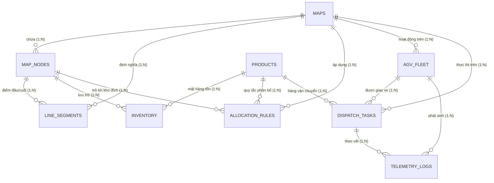

# ĐẶC TẢ CHI TIẾT CƠ SỞ DỮ LIỆU & SƠ ĐỒ QUAN HỆ (ERD)
# AGV_VER2 WMS SYSTEM (PHIÊN BẢN V2.2)
> **Căn cứ kỹ thuật:** Schema SQLite (`server/database/schema.sql`) + Map-as-Code Sync + Kho đa mặt hàng.  
> **Cập nhật:** 2026-11-18

---

## 1. SƠ ĐỒ QUAN HỆ THỰC THỂ (ERD)

---

## 2. TỪ ĐIỂN DỮ LIỆU CHI TIẾT (`schema.sql`)

> **Lưu ý đồng bộ Map-as-Code (`MapRepository.upsert_map_config`):** `inventory` và `allocation_rules` có khóa ngoại `ON DELETE CASCADE` tới `map_nodes(map_id, node_id)`. Vì vậy khi đồng bộ từ `config/active_map.json` qua `tools/sync_map.py --apply-db` hoặc khi khởi động lại Server, hệ thống **chỉ UPSERT** từng bản ghi (không xóa trắng `map_nodes`), bảo toàn 100% tồn kho và chặn xóa trạm đang còn hàng (`quantity > 0`).

### 2.1. Nhóm Bản đồ & Mạng lưới Line
- **`maps`**: `map_id` (PK), `name`, `width_m`, `length_m`, `description`, `is_active` (`1` active), `created_at`. *(Mã băm `map_hash` được tính động nhất quán với JSON/Firmware qua `MapRepository.compute_map_hash`.)*
- **`map_nodes`**: `(map_id, node_id)` (PK), `name`, `node_type` (`INBOUND`, `STATION`, `INTERSECTION`, `CHARGING`, `PARKING`), `x`, `y`, `color`, `max_capacity`, `is_occupied`, `occupied_by_agv`. Trạm `INBOUND` đóng vai trò trạm gốc `home_node`.
- **`line_segments`**: `(map_id, segment_id)` (PK), `from_node`, `to_node`, `distance_m`, `direction` (`ONE_WAY`/`TWO_WAY`), `heading_deg`, `speed_limit_cm_s`, `has_gap`, `is_locked`, `locked_by_agv`, `updated_at`.

### 2.2. Nhóm Hàng hóa, Tồn kho & Phân bổ
- **`products`**:
  - `product_code` (PK, vd: `'PKG_ELEC'`, `'PKG_MECH'`, `'PKG_TOOL'`)
  - `product_name`, `category`, `description`, `created_at`
  - `yolo_class_id` (`INTEGER UNIQUE NOT NULL`): Class ID đồng bộ theo CV Ver3 (`server/weights/class_names.json` cho `yolo11n_v5b_best.pt` + `best.pth`): `0` (`cylinder`), `1` (`rectangular_box`), `2` (`triangular_prism`).
- **`inventory`**: `inventory_id` (PK), `map_id`, `node_id`, `product_code`, `quantity`, `updated_at`, `UNIQUE(map_id, node_id, product_code)`.
- **`allocation_rules`**: `rule_id` (PK), `map_id`, `product_category`, `product_code`, `target_node_id`, `priority` (`1` cao nhất), `is_active`.

### 2.3. Nhóm Đội xe, Nhiệm vụ & Telemetry
- **`agv_fleet`**: `agv_id` (PK), `map_id`, `status` (`OFFLINE`, `IDLE`, `RUNNING`, `UNLOADING`, `CHARGING`, `EMERGENCY`), `current_node`, `target_node`, `current_task_id`, `x`, `y`, `yaw_deg`, `speed_cm_s`, `voltage_v`, `current_a`, `battery_pct`, `battery_type`, `last_ack_id`, `last_heartbeat`.
- **`dispatch_tasks`**: `task_id` (PK), `task_code` (UNIQUE), `map_id`, `product_code`, `product_name`, `from_node`, `to_node`, `route_path`, `assigned_agv`, `ai_confidence` (độ tin cậy từ CV Ver3 YOLO11n + MobileNetV3 + Geometry `0.00 - 1.00`), `image_path`, `status`, `dwell_time_sec`, `error_message`, `created_at`, `started_at`, `completed_at`.
- **`telemetry_logs`**: `log_id` (PK), `agv_id`, `map_id`, `timestamp`, `station`, `leg`, `x`, `y`, `yaw`, `dist`, `speed`, `line_mask`, `line_err`, `voltage`, `current`, `power`, `energy_mah`, `state`, `task_id`.
- **`system_events`**: `event_id` (PK), `event_type`, `source`, `message`, `details`, `created_at`.
