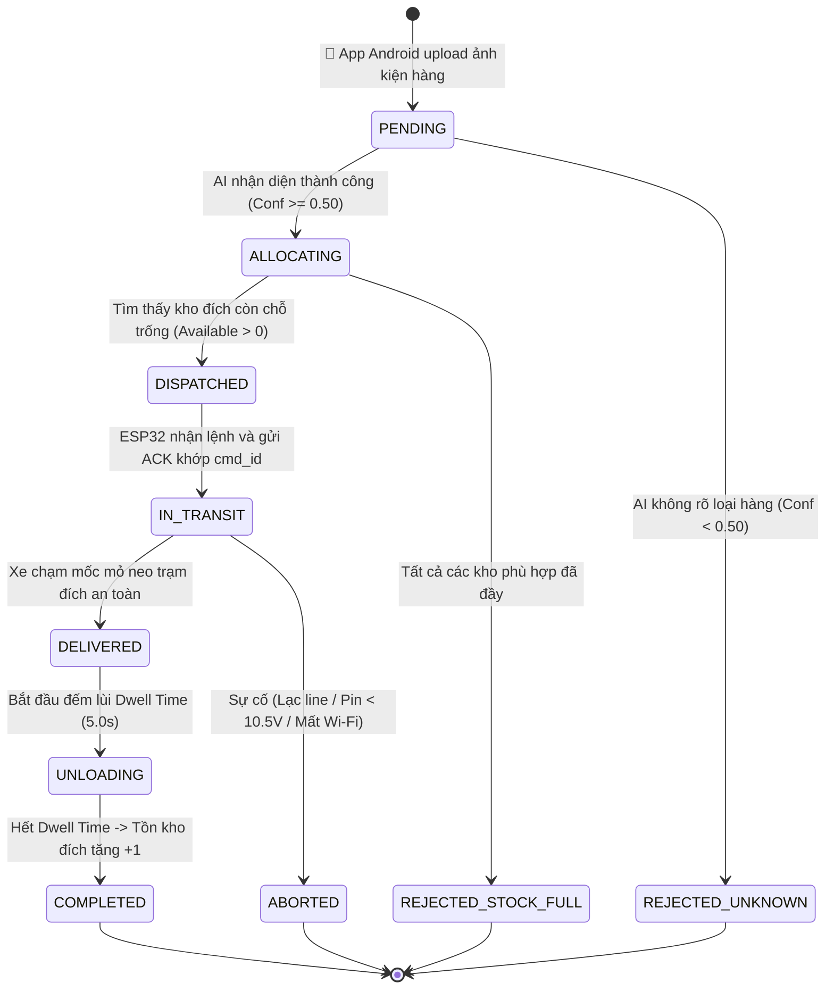
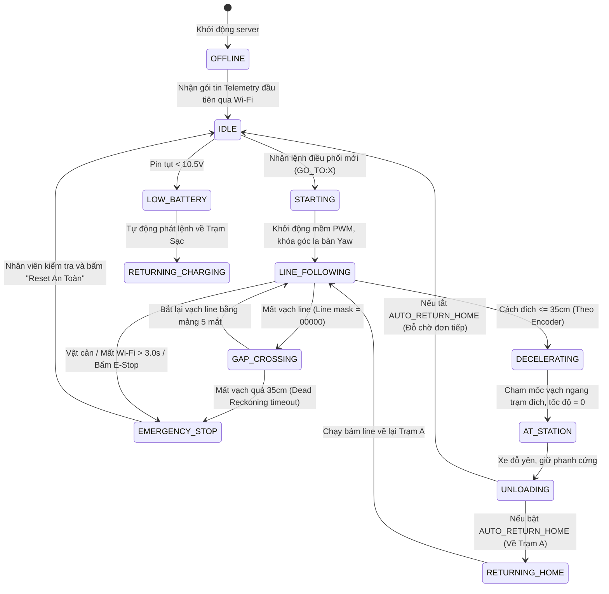
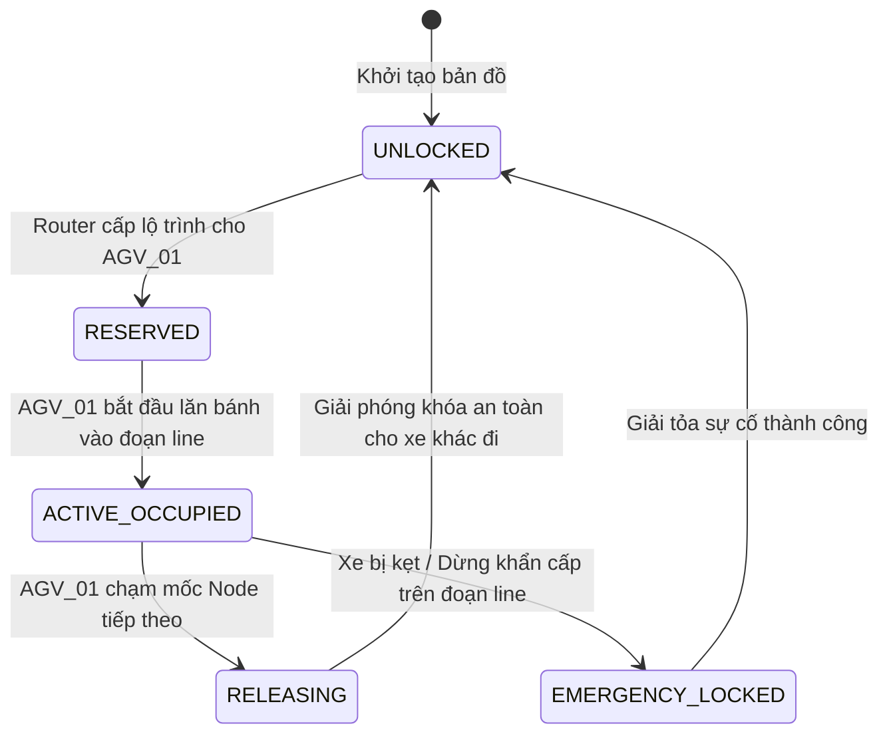

# ĐẶC TẢ CHI TIẾT MÁY TRẠNG THÁI & LUỒNG HOẠT ĐỘNG
# AGV_VER2 WMS SYSTEM (PHIÊN BẢN V2.1)
> **Căn cứ kỹ thuật:** Quản lý vòng đời nhiệm vụ (Task Lifecycle), máy trạng thái xe AGV và khóa cung đường sa bàn (Traffic Zone Locking).  
> **Cập nhật:** 2026-11-05

---

## 1. TỔNG QUAN KIẾN TRÚC MÁY TRẠNG THÁI PHÂN TẦNG (HIERARCHICAL FSM)

Hệ thống được thiết kế theo mô hình **Máy Trạng Thái Hữu Hạn Phân Tầng (Hierarchical Finite State Machine - HFSM)** gồm 3 máy trạng thái chạy song song và tương tác chặt chẽ với nhau:

```
┌────────────────────────────────────────────────────────────────────────┐
│                   HỆ THỐNG MÁY TRẠNG THÁI AGV_VER2 WMS                 │
├──────────────────┬────────────────────────────┬────────────────────────┤
│ 1. TASK FSM      │ 2. AGV MOTION & SAFETY FSM │ 3. TRAFFIC SEGMENT FSM │
│ (Quản lý vòng    │ (Quản lý hành vi di chuyển │ (Quản lý khóa đoạn     │
│  đời Đơn hàng)   │  và an toàn của xe AGV)    │  line sa bàn đa xe)    │
└──────────────────┴────────────────────────────┴────────────────────────┘
```

---

## 2. CHI TIẾT CÁC MÁY TRẠNG THÁI

### 2.1. Máy Trạng Thái 1: Vòng Đời Nhiệm Vụ (Task Lifecycle FSM)

Máy trạng thái này quản lý toàn bộ quá trình từ lúc kiện hàng được đặt lên xe tại Trạm Nhập A, AI nhận diện, WMS phân bổ kho, xe vận chuyển, dỡ hàng cho đến khi kết thúc.



#### Bảng Ma Trận Chuyển Trạng Thái Của Task:
| Trạng thái hiện tại | Sự kiện kích hoạt (Event) | Điều kiện kiểm tra (Guard) | Trạng thái tiếp theo | Hành động thực thi (Action) |
| :--- | :--- | :--- | :--- | :--- |
| **None** | `IMAGE_UPLOADED` | File ảnh hợp lệ | `PENDING` | Lưu ảnh, kích hoạt AI Worker xử lý |
| `PENDING` | `AI_CLASSIFIED` | `Confidence >= 0.50` | `ALLOCATING` | Lưu mã sản phẩm, gọi Allocation Engine |
| `PENDING` | `AI_LOW_CONFIDENCE` | `Confidence < 0.50` | `REJECTED_UNKNOWN` | Ghi log cảnh báo lên Web Dashboard |
| `ALLOCATING` | `TARGET_FOUND` | `available_slots > 0` | `DISPATCHED` | Lập lộ trình, nạp lệnh `pending_command` |
| `ALLOCATING` | `ALL_STATIONS_FULL` | `available_slots == 0`| `REJECTED_STOCK_FULL` | Bật còi báo kho đầy trên Web |
| `DISPATCHED` | `AGV_ACK_RECEIVED` | `ack_id == cmd_id` | `IN_TRANSIT` | Khóa các đoạn line tương ứng trên sa bàn |
| `IN_TRANSIT` | `ARRIVED_AT_DEST` | Xe báo `AT_STATION` | `DELIVERED` | Kích hoạt bộ đếm thời gian Dwell Time |
| `IN_TRANSIT` | `SAFETY_TRIGGERED` | Lạc vạch hoặc Pin yếu| `ABORTED` | Phanh dừng khẩn cấp, mở khóa đường line |
| `DELIVERED` | `DWELL_TIME_EXPIRED` | Đã đỗ đủ $5.0\text{giây}$| `COMPLETED` | Tăng số lượng tồn kho $+1$, gửi WebSocket |

---

### 2.2. Máy Trạng Thái 2: Trạng Thái Vận Hành & An Toàn Xe AGV (AGV Motion & Safety FSM)

Máy trạng thái này chạy đồng bộ giữa Server và Vi điều khiển ESP32-S3:



#### Bảng Ma Trận Chuyển Trạng Thái Của Xe AGV:
| Trạng thái hiện tại | Sự kiện kích hoạt (Event) | Điều kiện kiểm tra (Guard) | Trạng thái tiếp theo | Hành vi phần cứng (ESP32 / Server) |
| :--- | :--- | :--- | :--- | :--- |
| `OFFLINE` | `HEARTBEAT_RECEIVED` | Gói HTTP hợp lệ | `IDLE` | Server bật đèn xanh Online trên Web |
| `IDLE` | `TASK_DISPATCHED` | Có lệnh `GO_TO:<Node>` | `STARTING` | Tăng dần PWM động cơ (Khởi động mềm) |
| `IDLE` | `VOLTAGE_LOW` | Pin $< 10.5\text{V}$ | `LOW_BATTERY` | Khóa nhận đơn mới, cảnh báo sạc pin |
| `STARTING` | `MOTION_INITIATED` | Tốc độ $> 5\text{cm/s}$ | `LINE_FOLLOWING` | Bật thuật toán điều khiển bám vạch PD |
| `LINE_FOLLOWING` | `LINE_LOST` | Cảm biến `mask == 0` | `GAP_CROSSING` | Chạy thẳng quán tính bằng MPU-6050 |
| `GAP_CROSSING` | `LINE_REACQUIRED` | Cảm biến `mask > 0` | `LINE_FOLLOWING` | Khóa lại tâm vạch, tiếp tục chạy PD |
| `GAP_CROSSING` | `GAP_DISTANCE_EXCEEDED`| Chạy $> 35\text{cm}$ vẫn mất| `EMERGENCY_STOP` | Phanh dừng tức thì, hú còi Buzzer |
| `LINE_FOLLOWING` | `APPROACHING_TARGET`| Khoảng cách còn $\le 35\text{cm}$| `DECELERATING` | Giảm tốc độ từ $22\text{cm/s} \rightarrow 12\text{cm/s}$ |
| `DECELERATING` | `STATION_ANCHOR_DETECTED`| Cảm biến gặp vạch ngang| `AT_STATION` | Ngắt động cơ, khóa phanh chủ động |
| `AT_STATION` | `UNLOAD_STARTED` | Đã dừng đỗ an toàn | `UNLOADING` | Giữ phanh đỗ, chờ dỡ hàng $5.0\text{s}$ |
| Bất kỳ | `WATCHDOG_TIMEOUT` | Mất tín hiệu $> 3.0\text{s}$ | `EMERGENCY_STOP` | Hardware Failsafe: Tự ngắt motor |

---

### 2.3. Máy Trạng Thái 3: Khóa Cung Đường Sa Bàn (Traffic Segment Lock FSM)

Phục vụ bài toán điều phối giao thông **nhường đường và tránh va chạm đa AGV**:



---

## 3. THUẬT TOÁN ĐỊNH TUYẾN TÔ-PÔ (TOPOLOGICAL LINE ROUTING)

Hệ thống tích hợp thuật toán **Dijkstra** trên đồ thị các đoạn line (`line_segments`):

1. **Đầu vào (Input):**
   - Bản đồ hiện tại (`map_id`).
   - Điểm xuất phát (`from_node`) và Điểm đích (`to_node`).
   - Danh sách các đoạn line đang bị khóa bởi xe khác (`is_locked == 1`).
2. **Quy trình xử lý (Process):**
   - Bỏ qua các đoạn line đang bị khóa (tránh xung đột va chạm).
   - Tìm chuỗi các đoạn line có tổng chiều dài $\sum \text{distance\_m}$ là nhỏ nhất.
   - Tính toán góc quay cần thiết tại từng ngã rẽ:
     $$\Delta \theta = \text{heading\_deg}_{\text{next}} - \text{heading\_deg}_{\text{current}}$$
     - $\Delta \theta \approx 0^\circ \rightarrow$ Đi thẳng.
     - $\Delta \theta \approx 90^\circ \rightarrow$ Rẽ phải $90^\circ$.
     - $\Delta \theta \approx -90^\circ \rightarrow$ Rẽ trái $90^\circ$.
     - $\Delta \theta \approx 180^\circ \rightarrow$ Quay đầu $180^\circ$.
3. **Đầu ra (Output):**
   - Danh sách các Node đi qua: `['A', 'B']` hoặc `['A', 'B', 'C']`.
   - Danh sách các đoạn line cần khóa: `['SEG_AB']` hoặc `['SEG_AB', 'SEG_BC']`.
   - Lệnh điều khiển gửi xuống xe: `GO_TO:<Target>` kèm lộ trình chi tiết.
