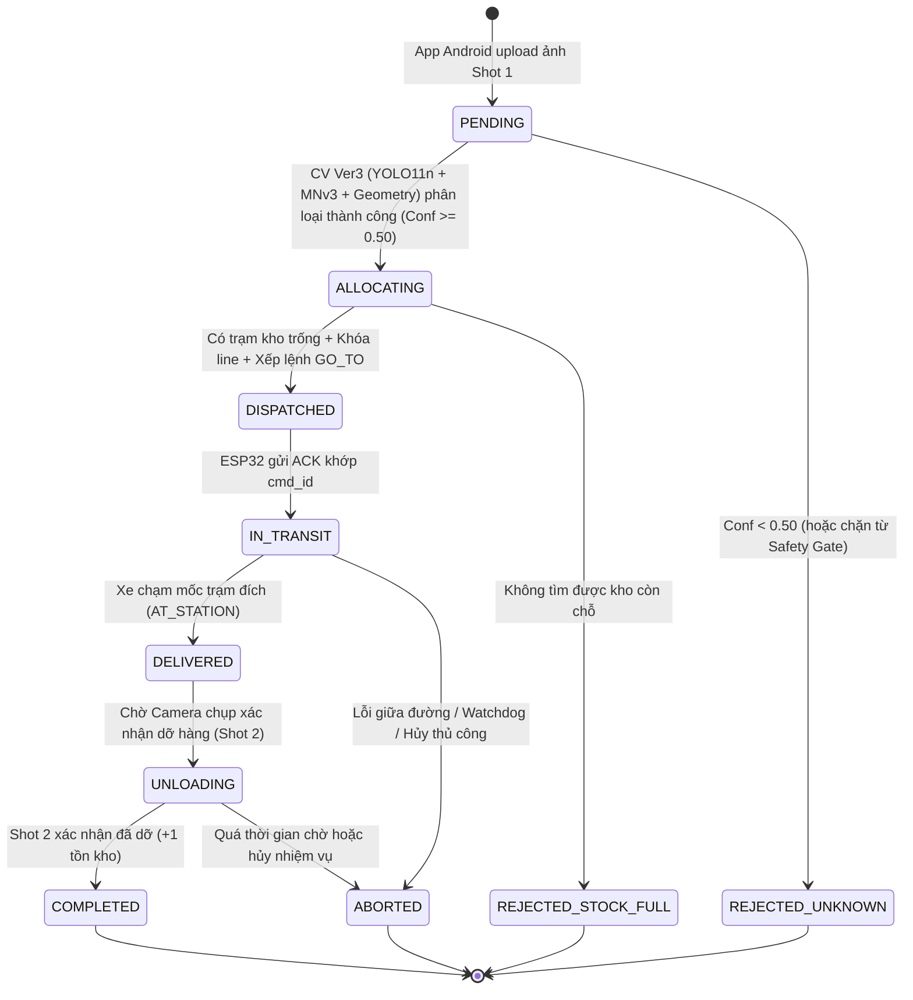
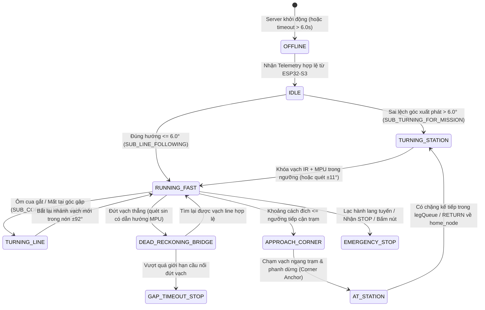
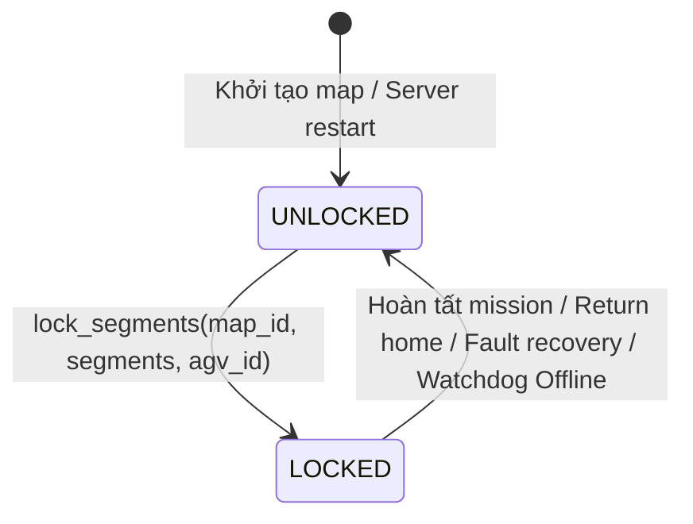

# ĐẶC TẢ CHI TIẾT MÁY TRẠNG THÁI & LUỒNG HOẠT ĐỘNG
# AGV_VER2 WMS SYSTEM (PHIÊN BẢN V2.3)
> **Căn cứ kỹ thuật:** Quản lý vòng đời nhiệm vụ (Task FSM), máy trạng thái điều khiển thực tế trên Firmware `test_10` và khóa cung đường sa bàn.  
> **Phiên bản:** 2.3 (Map-as-Code + CV Ver3) | **Cập nhật:** 2026-11-19

---

## 1. KIẾN TRÚC MÁY TRẠNG THÁI PHÂN TẦNG (HIERARCHICAL FSM)

```
┌────────────────────────────────────────────────────────────────────────┐
│                   HỆ THỐNG MÁY TRẠNG THÁI AGV_VER2 WMS                 │
├──────────────────┬────────────────────────────┬────────────────────────┤
│ 1. TASK FSM      │ 2. AGV MOTION & SAFETY FSM │ 3. TRAFFIC SEGMENT FSM │
│ (Vòng đời        │ (Trạng thái thực thi trên  │ (Khóa đoạn line trên   │
│  nhiệm vụ kho)   │  ESP32-S3 test_10 & Server)│  bản đồ đa chặng)      │
└──────────────────┴────────────────────────────┴────────────────────────┘
```

---

## 2. CHI TIẾT CÁC MÁY TRẠNG THÁI

### 2.1. Máy Trạng Thái 1: Vòng Đời Nhiệm Vụ (`TaskStateMachine` & `WMSWorkflowManager`)

Quản lý trọn vẹn chu trình **Shot 1 (Nhận hàng tại `home_node`) $\rightarrow$ Vận chuyển $\rightarrow$ Shot 2 (Xác nhận dỡ hàng tại trạm đích)**:



#### Bảng Chuyển Trạng Thái Chính:
| Trạng thái | Sự kiện kích hoạt | Điều kiện kiểm tra (Guard) | Trạng thái tiếp | Hành động |
| :--- | :--- | :--- | :--- | :--- |
| `PENDING` | `AI_CLASSIFIED` | `Conf >= 0.50`, không rơi vào `NO_OBJECT` / `NEEDS_REVIEW` | `ALLOCATING` | Tra `products` & `allocation_rules` |
| `ALLOCATING` | `TARGET_FOUND` | Có trạm còn `available_slots > 0` | `DISPATCHED` | Tìm đường TSP Dijkstra, khóa `line_segments`, cấp `GO_TO:<Node>` |
| `DISPATCHED` | `AGV_ACK_RECEIVED` | Telemetry `ack_id == cmd_id` | `IN_TRANSIT` | Cập nhật `started_at`, theo dõi lộ trình |
| `IN_TRANSIT` | `ARRIVED_AT_DEST` | Xe báo `AT_STATION` đúng `to_node` | `DELIVERED` $\rightarrow$ `UNLOADING` | Kích hoạt Camera chụp Shot 2 (`VERIFY_UNLOAD`) |
| `UNLOADING` | `VISION_UNLOAD_OK` | Khay trống hoặc hết hàng thuộc trạm hiện tại | `COMPLETED` | Cộng `+1` `inventory`, mở khóa line, chạy tiếp hoặc về `home_node` |
| `IN_TRANSIT`/`UNLOADING` | `FAULT`/`ABORT` | `GAP_TIMEOUT_STOP`, `LOST_LINE_STOP`, `ABORT` | `ABORTED` | Hủy mission kẹt, giải phóng khóa line |

---

### 2.2. Máy Trạng Thái 2: Vận Hành & Cứu Hộ Trên Firmware `test_10`

Đồng bộ giữa các sub-state thực tế trong `test/test_10_line_centric_hybrid_recovery.cpp` và Server `AGVState`:



*(Lưu ý: Trên tầng Server `AGVState`, `RUNNING_FAST`, `TURNING_STATION`, `TURNING_LINE`, `APPROACH_CORNER`, `DEAD_RECKONING_BRIDGE` được ánh xạ tổng quát vào trạng thái di chuyển `RUNNING` và chi tiết thô vẫn được lưu đầy đủ trong `telemetry_logs.state`.)*

---

### 2.3. Máy Trạng Thái 3: Khóa Cung Đường (`line_segments.is_locked`)



---

## 3. ĐỊNH TUYẾN DIJKSTRA (SERVER & FIRMWARE OFFLINE)

1. **Trên Server (`TopologicalRouter.find_shortest_path`):** Tìm đường ngắn nhất theo `distance_m` trên toàn đồ thị, bỏ qua các `segment_id` đang bị khóa bởi AGV khác, xuất `route_legs` (`from`, `to`, `dist`, `head`, `tx`, `ty`) gửi xuống ESP32.
2. **Dự phòng trên Firmware (`planAndExecuteRoute`):** Sử dụng bảng `runtimeNodes` / `runtimeEdges` (nạp từ `generated_map_config.h`, tối đa 16 trạm / 64 chặng) chạy Dijkstra $O(N^2)$ để vẫn điều hướng Point-to-Point được khi chạy Serial offline.
